```{r}
if(!require(emoji))
  install.packages("emoji")
library(emoji)
```

## <br>[`r rmarkdown::metadata$pagetitle`]{.monash-blue} {#etx2250-etf5922-title background-image="images/bg-01.png"}

### `r rmarkdown::metadata$subtitle`

Lecturer: *`r rmarkdown::metadata$author`*

`r rmarkdown::metadata$department`

::: tl
<br>

<ul class="fa-ul">

<li><i class="fas fa-envelope"></i>`r rmarkdown::metadata$email`</li>

<li><i class="fas fa-calendar-alt"></i> `r rmarkdown::metadata$date`</li>

<li><i class="fas fa-globe"></i> <a href="`r rmarkdown::metadata[["unit-url"]]`">`r rmarkdown::metadata[["unit-url"]]`</a></li>

<!--<li><i class="fa-solid fa-globe"></i>\<a href="`r rmarkdown::metadata[["unit-url"]]`"\>`r rmarkdown::metadata[["unit-url"]]`</a></li>
-->
</ul>

<br>
:::

## Today's lecture

::: {.callout-note}
## What we'll cover:

-   [Unit overview](https://dvac.ss.numbat.space/) and details

-   An Introduction to Data Visualisation

    -   Societal importance of data visualisation

    -   Learn about the different types of data

-   Getting you set up using Quarto and R (Hands on)
:::

. . . 

::: {.callout-note appearance="minimal"}
Building the foundation for [Unit Learning Outcomes](https://dvac.ss.numbat.space/) 1 and 2.
:::

## Acknowledgement of Country {background-image="images/lecture-01/banner_indigenous.jpg" background-opacity="0.5"}

::: {.callout-note appearance="minimal" style="background-color: rgba(220, 220, 220, 0.7);"}

I wish to acknowledge the people of the Kulin Nations, on whose land we are gathered today. I pay my respects to their Elders, past and present.

In this unit, we will learn about data visualisation and communication. This is not a new topic. 

Indigenous Australian rock art uses visual symbols for knowledge and storytelling. These symbols map the land, and pass down cultural and survival lessons across tens of thousands of years.

[Link to examples of common symbols](https://www.commonground.org.au/article/communicating-through-art-first-nations-symbols)

:::

::: {.callout-note appearance="minimal" style="background-color: rgba(220, 220, 220, 0.7);"}
## Resources
* [Fact sheet on Indigenous Rock Art](https://www.firstpeoplesrelations.vic.gov.au/fact-sheet-aboriginal-rock-art)
* [Rock Art you can visit in Victoria](https://www.visitgrampians.com.au/see-do/culture/indigenous-culture/aboriginal-rock-art-sites)
* [Indigenous education, research and leadership at Monash](https://www.monash.edu/about/who/indigenous)
:::

# Teaching Team {background-color="#006DAE"}

## About your Teaching Team

::::: columns
::: {.column width="40%"}
<center></center>

**Kate Saunders**

Senior Lecturer  
Monash University  
[Website](https://katerobsau.github.io/website-quarto/)

:::

::: {.column width="60%"}

:::{.callout-note}
## About Kate

-   `r emoji("graduation")` PhD in Statistics

-   `r emoji("globe")` Home State is Queensland

-   `r emoji("coder")` Research is in statistics of climate extremes

-   `r emoji("coder")` Passionate about open data, data visualisation and data ethics

-   `r emoji("coder")` Started R coding in 2012 (before tidyverse!)

-   `r emoji("heart")` Hobby is playing real basketball and fantasy basketball.
:::

:::
:::::

## About your Teaching Team

::::: columns
::: {.column width="40%"}
<center></center>

**Fonti Kaur**

Lecturer  
Monash University  
[Website](https://fontikar.github.io/)

:::

::: {.column width="60%"}

:::{.callout-note}
## About Fonti

-   `r emoji("graduation")` PhD in ... 

-   `r emoji("globe")` Home is ... 

-   `r emoji("coder")` Research / teaching ... 

-   `r emoji("coder")` R .... 

-   `r emoji("coder")` Packages ... 

-   `r emoji("heart")` Hobby is 

:::

:::
:::::

## Get to know your peers!

:::: {.columns}

::: {.column width="50%"}

::: {.callout-note}
## Break-out activity

Introduce yourself the people around you.  
You might like to ask each other: 

* Where are you from?
* What are you studying and why? 
* What do you for fun? Hobbies?
* Something memorable about you?

:::

:::

::: {.column width="50%"}


<span style="font-size: 0.5em; color: grey;"><a href="https://commons.wikimedia.org/wiki/File:Coffee_and_Friends_(Unsplash).jpg" style="color: grey;">Nathan Dumlao nate_dumlao</a>, CC0, via Wikimedia Commons</span>
:::

::::

# Unit Details {background-color="#006DAE"}

## Unit Developers

::: {.callout-note appearance="minimal"}
The material in this unit was mainly developed by Dr. Kate Saunders and Dr. Shanika Wickramasuriya, but there have been many contributors to the unit design and teaching over the years. 
:::

::::: columns
::: {.column width="50%"}
<center>

**Kate Saunders**

</center>

:::

::: {.column width="50%"}
<center>

**Shanika Wickramasuriya**

</center>

:::

:::::

## Why take this unit?

:::: {.columns}

<!--Data Visualisation is important! -->
A picture says a 1000 words

::: {.column width="45%"}
::: {.callout-tip appearance="minimal"}
## Visualisation ...

::: incremental

- Is a fundamental skill in quantitative analysis and reporting
- Supports efficient and clear communication
- Turns data into insights 
- Shows patterns, trends, structure, irregularities, relationships among data

:::
:::
:::

::: {.column width="55%"}
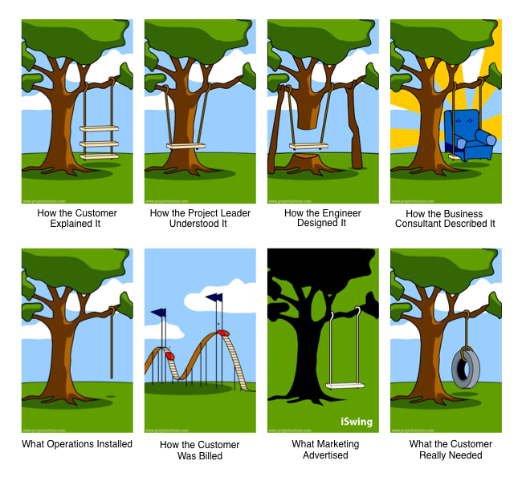{fig-align="center"}

<!--https://www.cleanpng.com/png-tree-swing-humor-customer-vs-expert-perspectives-tvmebg/download-png.html-->
:::

::::

## Disclaimer: SSA is an [**INTENSIVE**]{style="color:red;"} unit!

:::: callout-important
## What that means:

::: incremental
-   We will cover 12 weeks of material in 4 weeks

-   We will cover 3 lectures each week

-   That's \~36 hours of study each week! (= Full time job)

-   You will need to keep up with the material

-   Coming to classes and consultations will help you

-   [**Last minute cramming won't be possible**]{style="color:red;"}
:::
::::

## Unit Design

:::: callout-note
## Compared to normal semesters the content is condensed.

::: incremental
-   There sometimes will be pre-recorded material for you to watch in your own time.
<!-- -   [**Watch any pre-recorded material**]{style="color:red;"} before class -->

-   Lectures and tutorials will run together as a workshop in one class block.

-   The balance of lecture material to in class activities will change a little each week.

-   The unit is on campus, but there is a zoom link if you need it

:::
::::

. . . 

:::: callout-note
## Where to find materials 

[Unit Website](https://dvac.ss.numbat.space/): Lectures, tutorials, solutions

[Moodle](https://learning.monash.edu/course/view.php?id=49841): Quizzes, assignments, assignment submission portal, data sets, zoom links

:::

## Learning Objectives

:::: callout-note
## At the end of this unit you will be able to:

::: incremental
1. Critique data visualisations using principles of graphical excellence, sound design judgement, and statistical thinking

2. Create data visualisations from complex data sets using contemporary technologies for business applications

3. Communicate data-driven insights tailored for audience, message and medium

4. Design interactive data visualisations and animations for data discovery and communication of complex dynamic patterns.

5. Formulate research questions from a data set with exploratory data analysis.

6. Design inclusive and accessible data visualisations for audiences with diverse perspectives, identities, skills and abilities

:::
::::

## Overview of the unit: Part 1

::: callout-tip
## Introduction to Data Visualisation

-   Workshop 1: Getting Started with Data Visualisation

-   Workshop 2: The Good, the Bad and the Ugly of Data Visualisation

-   Workshop 3: Visualisation in BI
:::

Note: There are group exercises in workshop 2 and 3 that you need to complete to do your 1st assignment.

## Overview of the unit: Part 2 

::: callout-tip
## Visualisation in R

-   Workshop 4: Visualisation in R: Plots of 1 - 2 Variables

-   Workshop 5: Data Wrangling in R for Visualisation

-   Workshop 6: Visualisation in R: Plots of 2 or more Variables

:::

## Overview of the unit: Part 3

::: callout-tip
## Language of Visual Communication

-   Workshop 7: Iterating your Visualisation

-   Workshop 8: Effective Communication

-   Workshop 9: Visual Storytelling

:::

## Overview of the unit: Part 4

::: callout-tip
## Advanced Topics in Visualisation

-   Workshop 10: Infographics (Uncertainty and Missing Data)

-   Workshop 11: Interactivity and Animation

-   Workshop 12: Revision 

:::

# Assessement {background-color="#006DAE"}

## Assessment: Quizzes

:::: callout-note
## Quizzes

::: incremental
-   12 quizzes related to each lecture and tutorial

-   Count the best 10 out of 12 quizzes

-   This allows you to miss 2 quizzes for sudden and short term emergencies.

-   So **no special consideration**: Do not leave them until the last minute

-   Quizzes are worth 1% each

-   10% of your total grade

-   ~ 3 Quizzes will be due each week

-   **Bonus:** No time limit and there are repeat attempts

:::
::::

## Assessments: Porfolio

:::: callout-note
## Portfolio

::: incremental
-   2 assignments worth 20% each; full submission will create a portfolio of work

-   40% of your total grade

-   Assignment 1 will cover content from parts 1 and 2; focus is on understanding and creating good visualisations

-   Assignment 2 will cover content from parts 3 and 4; focus is on communication and how to use supporting visuals

-   Apply for [special consideration](https://www.monash.edu/students/admin/assessments/extensions-special-consideration) centrally. (This includes short extensions of 48 hours)

-   If you need special consideration, apply ASAP and no later than 11.55 pm on the day your assessment is due.

- **Do not email me for special consideration.** You must apply centrally using the link above.

:::
::::

## Assessments: Exam

:::: callout-note
## Final exam

::: incremental
-   Exam is in the Febraury [Summer Semester Exam Block](https://www.monash.edu/students/admin/enrolments/summer-winter/dates)

-   50% of your total grade

-   You can take in 2 pages of notes and are allowed access to the unit website [TBC]

-   Can sit the exam anywhere with a reliable internet connection

-   I will run an additional session in January to help you study. Date: TBC

- The exam might seem far away, but you will need to keep up with class to do well. 

:::
::::

## Generative AI

:::columns

::: {.column width="40%"}
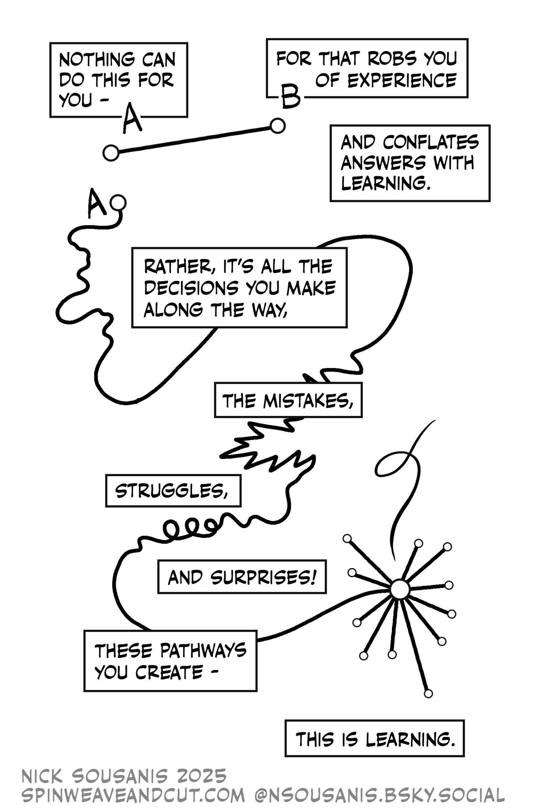
:::

::: {.column width="60%"}

:::callout-tip 
## You can use Generative AI in this unit. 

* In fact I encourage it! 

* It's a great tool for learning

* [Monash Guidance on Gen AI use](https://www.monash.edu/student-academic-success/build-digital-capabilities/create-online/using-artificial-intelligence)

:::

:::

:::

## Generative AI

:::columns

::: {.column width="40%"}

:::

::: {.column width="60%"}

:::callout-tip 
## You can use Generative AI in this unit. 

* In fact I encourage it! 

* It's a great tool for learning

* [Monash Guidance on Gen AI use](https://www.monash.edu/student-academic-success/build-digital-capabilities/create-online/using-artificial-intelligence)

:::

:::callout-warning 
## But be careful not to short cut your learning! 

* You must take full responsibility for what AI produces

* You must never misrepresent work AI produces as your own; see [ethical use](https://www.monash.edu/student-academic-success/ai-hub/responsible-and-ethical-use-of-ai)

* You must always provide [appropriate acknowledge of you AI use](https://www.monash.edu/student-academic-success/ai-hub/acknowledging-the-use-of-ai) 

:::

:::

:::

## Academic Integrity 

::: {.callout-caution minimal="true"}

## Break-out Activity: Are these okay? Yeah, nah or maybe?

* I use AI to complete my weekly quizzes 

* AI generates code to produce visualisations  for my portfolio and I write that in my AI use statement

* AI writes the personal reflection on my portfolio

* I use AI on my exam

:::

. . . 

::: callout-tip 
## Still not sure - Monash Resources

What is academic integrity? [Click here](https://www.monash.edu/students/study-success/academic-integrity)

What does maintaining academic integrity mean? [Click here](https://www.monash.edu/student-academic-success/learnhq/maintain-academic-integrity)

What happens if I breach academic integrity? [Click here](https://www.monash.edu/student-academic-success/maintain-academic-integrity/what-happens-if-i-breach-academic-integrity)

:::

<!--
# Getting Help {background-color="#006DAE"}

## Where to go if you need help

:::: callout-note
## 1. Ask your peers using the discussion forum

**Suitable for:**

::: incremental
-   General questions about course materials, tutorials, R or assignment clarifications.

-   Any emails regarding general matters will be redirected to the discussion forums.

-   Sharing helps you learn from each other!

-   Also I don't want to answer the same question twice (three times, four times etc.)

-   [**Do not**]{style="color:red;"} post code from your assignments or any assignment hints to the discussion portal. I may deduct marks
:::
::::

## Where else to go if you need help

:::: callout-note
## 2. Attend Consultation

**Suitable for:**

::: incremental
-   When you need more specific one-on-one help

-   Working through problems with your tutor

-   Getting a head start on your assignments

-   Support debugging your code

-   Asking detailed questions about your assignments

-   Getting additional feedback on your assessments

-   Being really nerdy about the unit!
:::
::::

## For personal and urgent inqueries

:::: callout-note
## Unit Email

**Suitable for:**

::: incremental
-   For personal questions or issues email etx2250-etf5922.caulfield-x\@monash.edu.

-   Response times are within 1 - 2 days but may vary during busy periods.

-   Also email if you notice issues with assessments or Moodle.

-   For remarking, get feedback on your assessment from your tutor and if this does not provide clarity email within 10 days of the due date.

-   [**Do not**]{style="color:red;"} direct emails to my staff account, I receive a high volume of high volume of emails and they risk going into a black hole and never being seen again!
:::
::::-->

## Where to go if you need help

<style>
.help-card {
  background: #f2f2f2;
  border-left: 6px solid #0d6efd;
  border-radius: 6px;
  padding: 0.6em 0.8em;
  transition: background 0.2s;
  cursor: pointer;
}
.help-card:hover { background: #e3eeff; }
.help-card h3 { margin: 0; font-size: 0.9em; }
.help-card .help-detail {
  max-height: 0;
  overflow: hidden;
  opacity: 0;
  font-size: 0.5em;
  transition: max-height 0.4s ease, opacity 0.4s ease;
}
.help-card:hover .help-detail {
  max-height: 600px;
  opacity: 1;
}
</style>

::::: {.columns}

:::: {.column width="35%" .help-card}
### 1. Mates & Moodle forum 💬

::: {.help-detail}
**Suitable for:**

- Ask a friend first 
- General questions about the unit materials, tutorials, or assignment $\rightarrow$ forum
-   Any emails about general questions will be redirected to the forum.
-   Sharing helps you learn from each other!
-   There is no point answering the same question twice (three times, four times etc.)
-   [**Careful**]{style="color:red;"} not to post code from your assignments or hints. I may deduct marks.
:::
::::

:::: {.column width="35%" .help-card}
### 2. Practice Session 🙋

::: {.help-detail}
**Suitable for:**

-   Can work through problems with support
-   One-on-one help
-   Get a head start on your assignments
-   Debug code / fix major issues
-   Ask detailed questions 
-   Getting additional feedback
-   Being really nerdy about the unit!
:::
::::

:::: {.column width="35%" .help-card}
### 3. Unit email ✉️

::: {.help-detail}
**For personal and urgent enquiries:**

-   Email etx2250-etf5922.caulfield-x\@monash.edu.
-   Response times are 1 - 2 days but may vary during busy periods.
-   Email if you notice issues with assessments or Moodle.
-   For remarking, get feedback from your tutor first. If this doesn't provide clarity, email within 10 days of the due date.
-   [**Do not**]{style="color:red;"} email my staff account. I receive a high volume of emails and they risk going into a black hole and never being seen again!
:::
::::

:::: {.column width="35%" .help-card}
### 4. AI assistants 🤖

::: {.help-detail}
**Suitable for:**

-   Explaining concepts in different words
-   Help understanding R error messages
-   Brainstorming ideas and checking your understanding

**Be careful:**

-   AI can be confidently wrong, so check against the unit materials.
-   [**Do not**]{style="color:red;"} paste assessment questions directly into AI (Academic Integrity Breach)
-   You are responsible for what you submit.
:::
::::

:::::

# Time to get started

Let's develop some intuition for why data visualisations are important!

# Famous Historical Visualisations {background-color="#006DAE"}

## A history lesson

:::: callout-note
## Cholera

::: incremental
-   In 1854 there was a breakout of the cholera disease in London killing 616 people.

-   At the time it was speculated that the disease was carried in the air.

-   A physician called John Snow was skeptical and began to collect data...
:::
::::

## Original Map

```{r,chlorera_org, echo = FALSE, out.width = "50%", fig.align='center'}
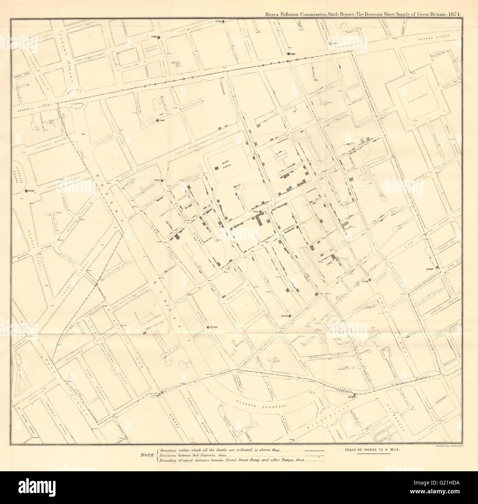
```

## Close Up

```{r,chlorera_new, echo = FALSE, out.width = "70%", fig.align='center'}

```

## Consequences

:::: callout-note
## Map of outbreaks

::: incremental
-   The map showed the cholera was more prevalent around a water pump on Broad Street.

-   The pump was closed down.

-   Eventually it was established that cholera is a water-borne disease.

-   Data visualisation saves lives!
:::
::::

## Crimean War

:::: callout-note
## Florence Nightingale `r emoji("heart")`

::: incremental
-   At the same time Great Britain was at war against Russia in the Crimean peninsula.

-   Florence Nightingale is famous as a nurse who treated the wounded soldiers.

-   She also advocated to the British Parliament for more sanitary conditions in military hospitals.

-   She knew the power of using data visualisation.
:::
::::

## Original Rose Chart

```{r, rose_chart, echo = FALSE, out.width = "70%", fig.align='center'}
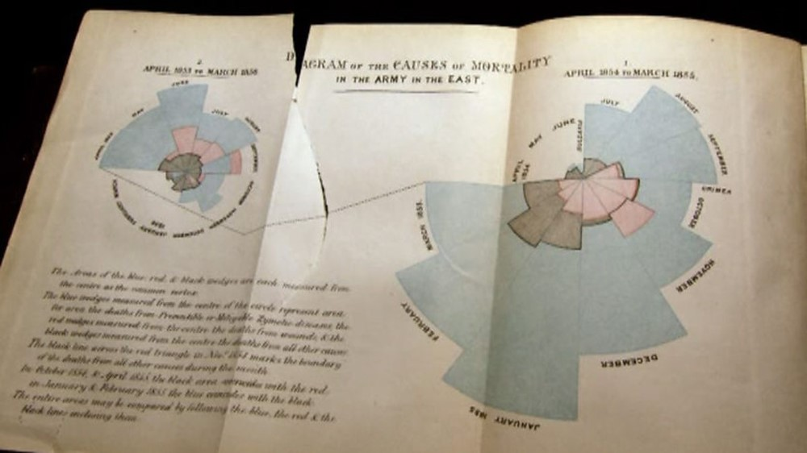
```

## Recreation of Nightingale's Rose chart

```{r,rose_chart_modern, echo = FALSE, out.width = "50%", fig.align='center'}
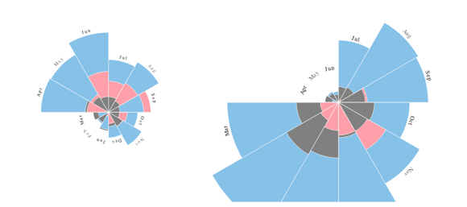
```

-   Blue areas: Preventable deaths
-   Red areas: Deaths from battle wounds
-   Black areas: Other causes

## Aftermath

:::: callout-note
## Rose chart

::: incremental
-   The improved sanitation at military hospitals was eventually implemented in civilian hospitals.

-   Data visualisation saves lives.

-   Florence Nightingale became the first female member of the Royal Statistical Society.
:::
::::

## Napoleon

:::: callout-note
## Background

::: incremental
-   In 1812 Napoleon thought it was a good idea to invade Russia.

-   This campaign was a disaster for the French.

-   Engineer Charles Joseph Minard captured the extent of this catastrophe using visualisation.
:::
::::

## Minard's Plot

```{r,napoleon, echo = FALSE, out.width = "100%", fig.align='center'}
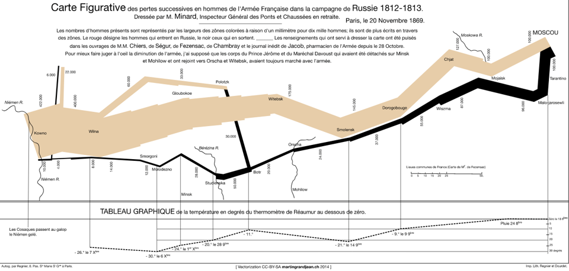
```

## Minard's plot

:::: callout-note
## Infographic

::: incremental
This visualisation provides information on [6 variables in one chart](https://closeread.dev/gallery/examples/minards-map/).

-   Number of troops

-   Whether troops advance or retreat

-   Temperature and time

-   Longitude and latitude

Despite the clear message that invading Russia in winter is a bad idea, some people did not learn this lesson.
:::
::::

## A bit more on Minard

<iframe width="1120" height="500" src="https://www.youtube.com/embed/sQdpQkDGCAU" title="YouTube video player" frameborder="0" allow="accelerometer; autoplay; clipboard-write; encrypted-media; gyroscope; picture-in-picture" allowfullscreen>

</iframe>

[^1]

[^1]: Source: https://infowetrust.com/finding-minard\] Minard was so well regarded that all Ministers of Public Works in France had his creations in the background of their portraits from 1850-1860.

## What about Modern Visualisations? 

<br><br><br>

:::callout-note
## Break-out discussion

Take some time to discuss in groups where you encounter data visualisation in your everyday life?

:::

# High Profile Data Visualisations {background-color="#006DAE"}

## COVID19 Pandemic

:::: callout-note
## Background

::: incremental
-   In the early stages of the COVID19 pandemic, hospital capacity was not able to cope with the amount of cases.

-   Collectively as a society we needed to to slow the spread of the virus and reduce the load on our healthcare systems.

-   People needed to understand and listen to the public health advice about hand washing, social distancing and quarantining etc.

-   Let's look at some visualisations that helped get the importance of this message across!
:::
::::

## Flattening the Curve

A visualisation showing the importance of slowing the spread and reduce the peak in cases ([Source](https://en.wikipedia.org/wiki/Flattening_the_curve)).

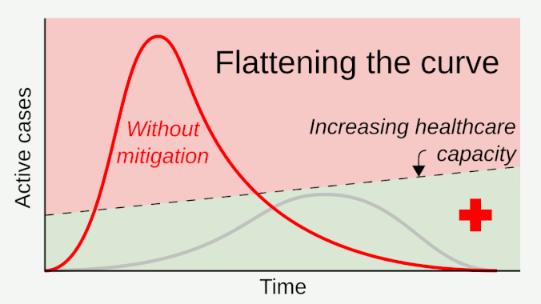{fig-align="center"}

## Social Distancing

A visualisation showing the importance of social distancing ([Source](https://en.wikipedia.org/wiki/Flattening_the_curve)).

{fig-align="center"}

## Communicating Climate Change

:::: callout-note
## Background

::: incremental
-   Climate Change is leading to more frequent and more severe weather

-   There are severe socio-economic consequences as a result of more weather and climate extremes.

-   It is important to communicate with people that our climate is changing.

-   It is also important to communicate that if we reduce our emissions and take rapid action we can slow down the impacts of climate change.

-   Professor Ed Hawkins (University of Reading, UK) [created data visualisations](https://ed-hawkins.github.io/climate-visuals/stripes-future.html) to help with this!
:::
::::

## Warming Spiral

A visualisation showing the climate is warming. <br> This visualisation was shown at the Rio Olympics in 2016!

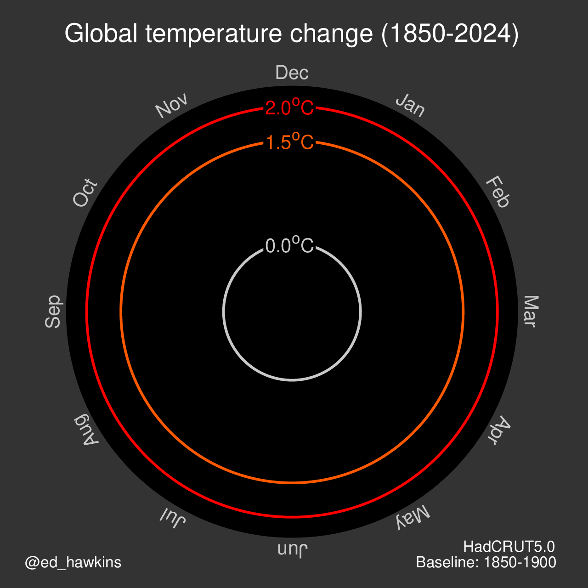{fig-align="center"}

## Future Climate

A visualisation showing that our choices today will impact our rate of future warming.

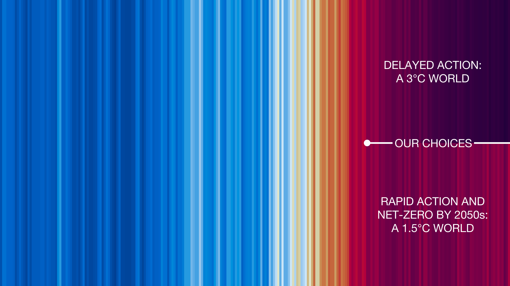{fig-align="center"}

## Politics

:::: callout-note
## Why visual political data?

::: incremental
-   Visualising election data helps people understand and trust the results

-   Common election visualisaitons focus on voter behaviour, such as differences in voters between regional areas and cities, or difference based on voters demographics (e.g. age, gender, income).

-   Visualisation also occurs in the polls in the lead up and on election night

-   Visualisation is also used by politicians to support their policy platforms
:::
::::

## 2024 US Elections: Polling

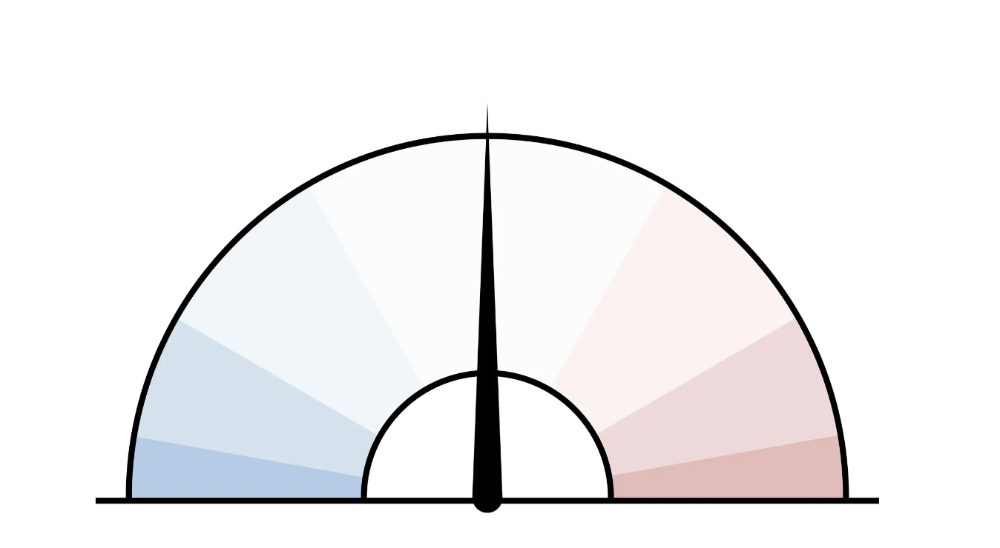{fig-align="center" width="1600"}

[Voter Needle](https://www.nytimes.com/article/election-2024-results-needle.html): Shows election results in context as they come in and displays the uncertainty in the total as votes are counted.

## 2025 Australian Federal Election: Spatial Trends

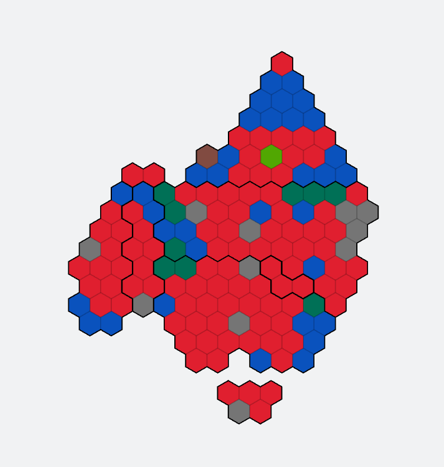{fig-align="center"}

[Tessalated Hexabin Maps](https://www.abc.net.au/news/elections/federal/2025/results?sortBy=latest&filter=all&selectedRegion=all&selectedParty=all&partyWonBy=all&partyHeldBy=all): Show election result by district on a map

## 2024 US Elections: Demographics

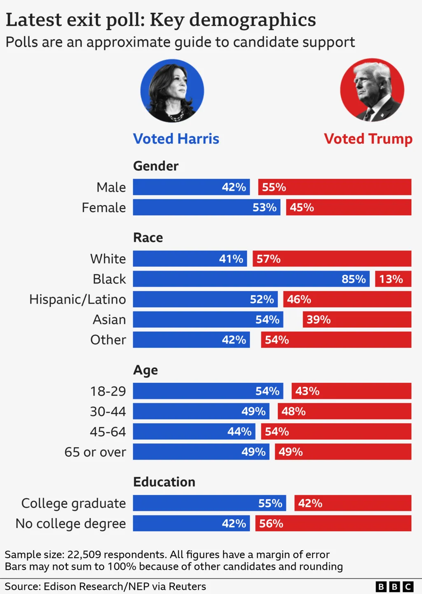{fig-align="center" width="1700"}

From [an article on 2024 US election results.](https://www.bbc.com/news/articles/c0lp48ldgyeo)

## 2024 US Elections: Policy

And here is the chart credited with saving President Trump's life.

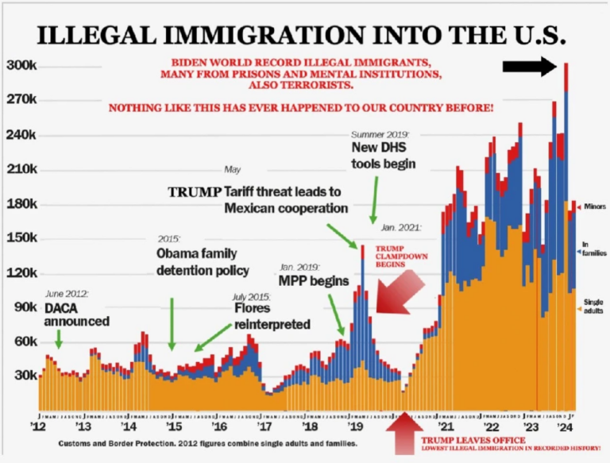{fig-align="center" width="1400"}

It doesn't adhere to the principles of graphical excellence, we'll show you why and provide a better example later!

# Types of data visualisation {background-color="#006DAE"}

A world of possibilities

## 

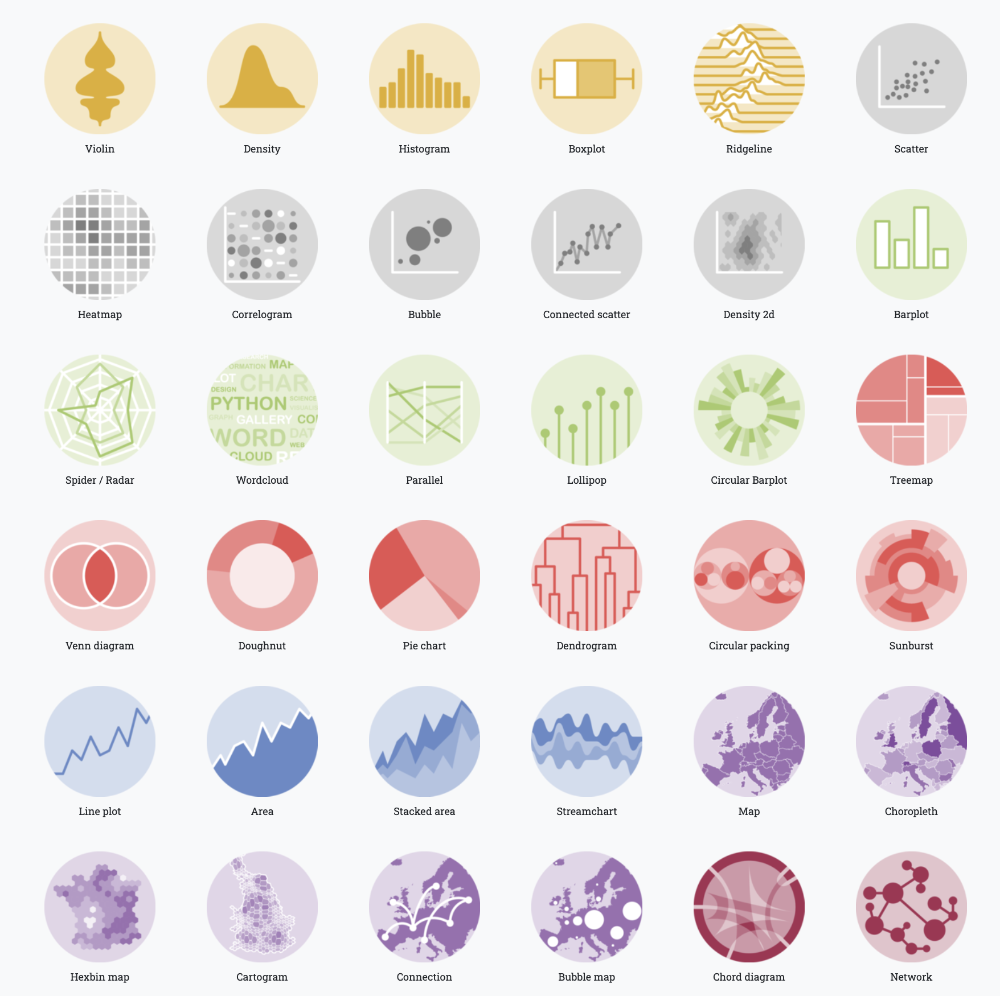{fig-align="center"}

## Matching the data the plot

There are lots of different kinds of visualisations.

But before we can create these visualisations ...

::: callout-note
## Need to learn:

-   Which type of plot works best for what type of data?

-   What are the different kinds of data variables?

-   What are different types of data?

-   What can those different kinds of data represent?

-   What can you show with that data?
:::

In other words: we need to learn how to go from [Data-to-Viz!](https://www.data-to-viz.com/)

## Discrete Variables

:::: callout-note
## Discrete Variables

::: incremental
-   **Discrete variables** can take only specific, separate values within a range.

-   Often represent **counts** or **whole numbers**.

-   **Example:** Number of students in a class, number of cars sold.

-   **Characteristics:**

    -   Finite set of values[^2] (e.g. Dice rolls takes values 1 to 6.)

    -   Cannot take on fractional values between two distinct points (e.g. can't saw in student in half!)
:::
::::

[^2]: This also includes countably finite, so counting numbers, 1, 2, 3, .... $\infty$, but that's a bit more technical.

## Categorical Variables

:::: callout-note
## Categorical Variables

::: incremental
-   **Categorical variables** are a type of discrete variable

-   Categorical variables represent categories or groups.

-   Often represented by labels or names rather than numbers.

-   Two types of Categorical Variables:

    -   **Nominal**: Categories with no logical order (e.g. your names)

    -   **Ordinal**: Categories with a meaningful order (e.g. low, medium, high)
:::
::::

## Nominal Variables

:::: callout-note
## Nominal Variables

::: incremental
-   **Nominal variables** are a type of categorical variable with no ordering.
-   **Example:**
    -   Blood type (A, B, AB, O)
    -   Types of pets (dog, cat, bird)
    -   People's names (Kate, Bets, Minh).
-   **Characteristics:**
    -   Purely descriptive labels.
    -   Cannot rank or order categories.
:::
::::

## Ordinal Variables

:::: callout-note
## Ordinal Variables

::: incremental
-   **Ordinal variables** have a natural order, but differences between values need not be meaningful.
-   **Examples:**
    -   Satisfaction levels (satisfied, neutral, dissatisfied),
    -   Education levels (high school, bachelor's, master's).
-   Characteristics:
    -   Categories can be ranked.
    -   Distances between categories may not be equal.
:::
::::

## Continuous Variables

:::: callout-note
::: incremental
-   **Continuous variables** can take any value within a range.
-   Typically represent **measurements** (e.g., height, temperature).
-   **Examples**:
    -   Weight of a person (kg)
    -   Time taken to complete a task (minutes).
-   **Characteristics**:
    -   Infinite number of possible values within a range.
    -   Can be divided into smaller increments.
:::
::::

## 

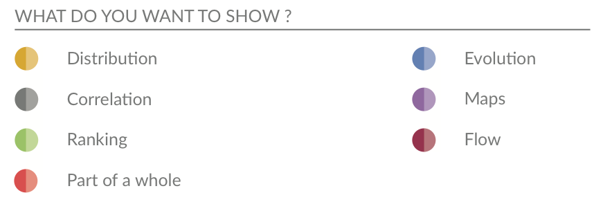{fig-align="center" width="1400"}

Step 1: Is understanding what your data is.

Step 2: Is understanding what you can show with your data.

## Common types of data relationships

:::: callout-note
## Spatial Data

::: incremental
-   **Spatial data** represents data related to physical locations or areas.
-   **Examples:**
    -   Regions on a map (Country names) - Discrete
    -   Geographic coordinates (latitude, longitude) - Continuous
-   **Characteristics:**
    -   Useful for mapping and showing spatial patterns.
:::
::::

## Common types of data relationships

:::: callout-note
## Temporal Data

::: incremental
-   **Temporal data** represents data associated with time.
-   Examples:
    -   Daily temperature readings (°C) - Continuous
    -   Daily energy consumption (kWh) - Continuous
    -   Number of sales per day (Hierarchy: store, region, state) - Discrete
-   **Characteristics**:
    -   Follows a sequential order.
    -   Useful for trend analysis and time series forecasting.
:::
::::

# Wrap up {background-color="#006DAE"}

## Summary

:::: callout-note
## Data visualisation is important!

::: incremental
-   We've seen examples of high profile and important data visualisations.

-   We've learnt when data visualisation is done right, it is a powerful tool for communication.

-   We've also seen an example of when data visualisation can be misleading.

-   An important part of this unit will be teaching you how to be critical of data visualisation.

-   You will learn what makes a good or bad visualisation, and to identify when a visualisaton is misleading.

-   We will revisit some of these examples in later.
:::
::::

## Summary

:::: callout-note
## Data to Visualisation

::: incremental
-   You've also learnt there are lots of different kinds of visualisations

-   We've learnt about different types of variables and what these variables can represent

-   This will be important for when we start building our own data visualisations

-   Take a closer look at the [Data-to-Viz website](https://www.data-to-viz.com/) to see what kind of data matches best with what plot.
:::
::::

# Getting set up {background-color="#006DAE"}

This content is all made available in the form of pre-recorded videos.

## First steps

::: callout-note
## Getting set up

-   By the end of this unit you'll be creating your own amazing, data visualisations

-   Before you can do that we need to get you set up with the software you'll use in this unit

-   We'll now go through the steps to install R and RStudio

-   Think about R as the paint (raw materials) and RStudio as the paintbrush and canvas (tools we need to bring the artwork together).
:::

<!-- ## Installing PowerBI -->

<!-- Another lecture  -->

## Installing R and RStudio

We'll open RStudio to create data visualisations using R.

:::callout-important 
## Step 2: Install R
- Got to https://www.r-project.org/
- Click "download R"
- Select a mirror (I use the Melbourne one)
- Install for your operating system
:::

::: callout-important 
## Step 2: Install RStudio

- Got to https://www.rstudio.com/products/rstudio/download/
(you only need the free version)
- Select download for your system
- Follow the prompts to install

:::

If you need more help refer to this [online module](https://startr.numbat.space/modules/starter/installation/)

## But Why?

::: callout-note
## Why do we need a Programming Language

-   It allows us to have reproducible steps, which can be applied for many different data sets

-   Make sure the analysis is not just point and click, you can work as a team on it on the same code

-   It also means we can more easily create our own bespoke visualisations
:::

::: callout-note
## Why do we use R?

-   It has been around for a while.

-   It is regularly maintained and is open source.

-   It is beginner friendly

-   Even if you use other languages, you might still use R for your data visualisations
:::

## Getting Started in R

:::: callout-note
## Learning a new language is hard!

::: incremental
-   You need to think about grammar and structure, and how to communicate well in it!

-   You will make mistakes, lots of them.

-   Below you see code that plots points showing the GDP per capita against life expectancy. The points are coloured by country and the size of the points shows the population.

-   It might look impossible now, but by the end of this semester you will be able to write this yourself!
:::
::::

```{r, eval = FALSE, echo = TRUE}
library(tidyverse)
library(gapminder)
plot <- ggplot(data = gapminder) + 
  geom_point(aes(x = gdpPercap, y = lifeExp, size = pop, colour = country)) + 
  theme(legend.position = "none")
plot 
```

# A Quick Intro to R {background-color="#006DAE"}

## Topics covered

:::callout-note 
## Important pieces 

-   Different parts of RStudio
-   Assigning variables
-   Different variable types
-   Reading in data and working directories
-   R Projects
-   Functions and R Packages
:::

## Checklist

::: callout-note
## Make sure you have

-   Have installed R and RStudio

-   Are able to set up a Project in R and know why we use them

-   Can read in data from a file into R

-   Know how to install packages and load the package libraries

-   Can assign variables and run basic functions
:::

<!-- # Strategies for learning R {background-color="#006DAE"} -->

<!-- ## How to learn R -->

<!-- 1.  Come to lectures and ask questions. -->

<!-- 2.  Look at your tutorial questions before the tutorial, & go along with specific questions. -->

<!-- 3.  Try to avoid copying code - instead focus on writing and understanding each bit. -->

<!-- 4.  Practice! The [Tidy Tuesday data sets](https://github.com/rfordatascience/tidytuesday) are a really fun place to start. -->

<!-- ## How to learn R -->

<!-- 5.  Have questions outside of class? Post questions on our discussion forum. You can also test out your knowledge by answering other's questions. -->

<!-- 6.  Completely stuck? Come to a consultation and talk it through with your tutor or lecturer. -->

<!-- 7.  Try talking to a [figurative rubber duck](https://en.wikipedia.org/wiki/Rubber_duck_debugging) - sometimes just explaining the problem can help you find a solution. -->

<!-- 8.  Use ChatGPT to help get you started, or to diagnose your errors -->

