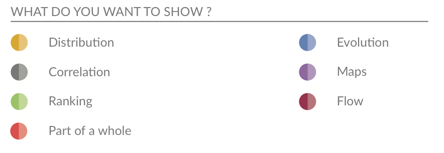
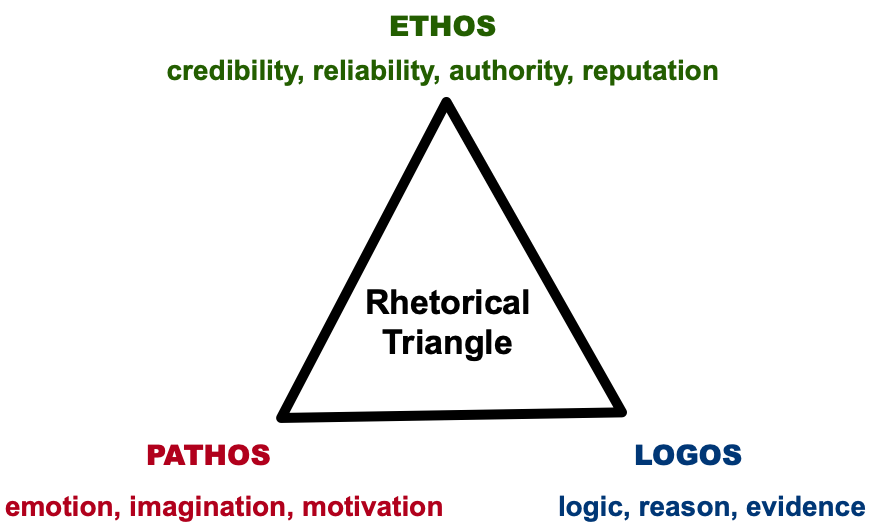

## <br>[`r rmarkdown::metadata$pagetitle`]{.monash-blue} {#etx2250-etf5922-title background-image="images/bg-01.png"}

### `r rmarkdown::metadata$subtitle`

Lecturer: *`r rmarkdown::metadata$author`*

`r rmarkdown::metadata$department`

::: tl
<br>

<ul class="fa-ul">

<li><i class="fas fa-envelope"></i>`r rmarkdown::metadata$email`</li>

<li><i class="fas fa-calendar-alt"></i> `r rmarkdown::metadata$date`</li>

<li><i class="fa-solid fa-globe"></i>\<a href="`r rmarkdown::metadata[["unit-url"]]`"\>`r rmarkdown::metadata[["unit-url"]]`</a></li>

</ul>

<br>
:::

## Learning Objectives

We've covered a lot of topics. 

Today will be a highlights tour.

::: {.callout-tip }

## Today's class

* Look at each of the lectures 

* Pull out *some* of the key messages 

* Give you some questions to help you revise for your exam

:::

# Week 1 {background-color="#006DAE"}

## Week 1 

::: callout-tip
## Introduction to Data Visualisation

-   Lecture 1: Getting Started with Data Visualisation

-   Lecture 2: The Good, the Bad and the Ugly of Data Visualisation

-   Lecture 3: Data Visualisation in BI
:::

## Day 1: Why take this unit?

<br>

:::: callout-tip
## Importance of Data Visualisation and Communication

::: incremental
-   Data visualisation is a starting point of every Business Analytics Project.

-   A picture says a 1000 words: We can turn data into insights using visualisation

-   Search and show patterns, trends, structure, irregularities, relationships among data

-   Integral for communicating results from an analysis with clarity and efficiency
:::
::::

## Day 1: Learning Objectives

:::: callout-note
## At the end of this unit you will be able to:

::: incremental
1.  Critically evaluate the quality of a data visualisation using the principles of graphical excellence

2.  Successfully create high-quality data visualisations for a given dataset using software, such as Power BI or R.

3.  Develop the skills to effectively use data visualisations to communicate insights to an audience

4. Develop the skills to effectively use data visualisations to communicate in the appropriate medium, such as report writing, in presentations and digital storytelling.

5.  Apply advanced topics in data visualisation, such as using interactivity and animation to enhance communication.

:::
::::

## Day 1: Variable types

:::callout-note 

## Introduction to plots

**Different types of variables:** 

* Discrete
  - Count
  - Categorical: Ordinal and Nominal
  
* Continuous

:::

. . . 

:::callout-warning
## Your turn 

* Can you think of examples for each of these variable types? 

* Do you know which variables are visualised best with which plot? (Remember: [data-to-viz](https://www.data-to-viz.com/))

:::

## Day 2: Good practice in data visualisation

:::: callout-important
## Tufte's Principles

::: incremental
-   Show the data
    -   Maximise data ink
-   Avoid distorting what the data have to say
    -   Do not create misleading visualisations
-   Present your data in a small space; efficiently with clarity.
    -   Optimise data density
-   Make large data sets coherent
    -   Use small multiples
-   Encourage the eye to compare different pieces of data
    -   Group your data appropriately
:::
::::

See the 'The Visual Display of Quantitative Information' by **Edward Tufte**.

## Day 2: Good practice in data visualisation

:::callout-warning 
## Your turn 

* Can you sketch examples of Tufte's principles in practice?

  - Good data-density vs bad data-density?  

  - Good data-ink vs bad data-ink?

* If given a visualisation - Can you identify if Tufte's principles are being used effectively?

* Do you understand how to use Tufte's principles to improve a visualisation?

:::


## Day 2: Perceiving visual elements

How the brain processes visual information is essential for creating effective visualisations.

:::: callout-note
## Key elements of human perception

These include:

::: incremental
-   Pre-attentive processing
-   Visual hierarchy
-   Encoding efficiency
-   Gestalt principles
-   Color perception
-   Pattern and trend recognition
-   Managing cognitive load
-   Cultural and contextual factors
:::
::::

## Day 2: Perceiving visual elements

:::callout-warning 
## Your turn 

* Can you describe each of these? 

* Which ones are most/least effective?

* Which visual elements do you notice first/last?

* Do you understand how to use these in visualisation? 

:::

## Day 2: Color Perception

::: callout-note
## Colour effectivness

-   **Contrast Sensitivity:** Luminescence (brightness /transparency) differences are more noticeable than colour differences

-   **Colour scales:** Different colour scales are better at representing different types of data

-   **Colourblind Accessibility:** Need to choose colour scales that are accessible (colour vision deficiencies in \~8% of men).
:::

. . . 

:::callout-warning 
## Your turn 

What colour scales work best for which variables?

:::

## Day 2: Bad plots

:::callout-note
## Bad plots

What makes plots *bad* can be broadly put into three categories:

-   Taste (Aesthetic)
-   Perception 
-   Data

:::

. . . 

:::callout-warning 
## Your turn 

Are you confident recognising common pitfalls and identifying features of a bad plot?

:::

## Day 3: Power BI vs R

::::::: columns
:::: {.column width="50%"}
::: callout-note
### Power BI

Power BI is ideal for day-to-day business reporting.

**Pros:**

-   User-friendly (no programming)
-   Easy to create dashboards
-   Real-time capabilities, and
-   Straightforward sharing

**Cons:**

-   Limited Customisation
-   Cost
:::
::::

:::: {.column width="50%"}
::: callout-note
### R

R is great for data scientists and analysts who need in-depth control over visualisations.

**Pros:**

-   Highly customisable
-   Suitable for advanced analytics
-   Open source (aka. free)
-   Automation / reproducibility (more than plug and play)

**Cons:**

-   Higher hurdle to entry - need to code.
-   Simple tasks don't need customisation
:::
::::
:::::::

## Day 3: Power BI vs R

<br>

:::callout-warning
## Your turn 

* Are you clear about which visualisation tool is best for the job? 
e.g. For what tasks would you use R vs Power BI? 

* Do you know how the different variable types are stored by a computer in both R and Power BI?

:::

## Day 3: Polishing you visualisation 

When you are happy with the plot you've chosen for your data it is time to polish the plot. 

:::callout-note 
### Steps

* Update all the plot labels
  * Title, axes labels, tick labels, legend text etc. 
  * Use intuitive and intelligent labels
  * You must include units where relevant
  * Ensure the text size is readable!
 
:::

## Day 3: Polishing you visualisation   

:::callout-note 
### Steps 

* Chose an appropriate colour scale

* Align your visual elements in your plot for clarity 
  * e.g. Think about legend position

* Check the final plot conveys the message you intend 
  * Be sure your plot proportions are good 
  * Check the range on your axes 
  
* May like to add additional text or colour to draw the eye to important parts of the plot you want to highlight

:::

. . . 

:::callout-warning
## Your turn 

If I give you a plot, could you describe what steps needs to be done to polish it?

:::


## Day 3: Plot types 

:::callout-note 
## Plot types

Covered different types of plots:

* Pies, Donuts

* Bars: Stacked, Clustered, Percentage

* Treemaps

* Gauges

* Maps 

:::

. . . 

:::callout-warning
## Your turn 

Do you know when to use each plot type and when not to use each plot type? (Remember: [data-to-viz](https://www.data-to-viz.com/))

:::

# Week 2 {background-color="#006DAE"}

## Week 2

::: callout-tip
## Visualisation in R

-   Lecture 4: Visualisation in R: Plots of 1 - 2 Variables

-   Lecture 5: Data Wrangling in R

-   Lecture 6: Visualisation in R: Plots of 2 or more Variables
:::

## Day 4: Grammar of Graphics

:::: callout-note
## Key ggplot layers include:

::: incremental
-   **Data**:
    -   The dataset you're visualising.\
-   **Aesthetic Mappings (`aes()` for short)**:
    -   Map variables to visual properties like x, y, color, size, etc.\
-   **Geometries (`geom_*`)**:
    -   Define the type of plot (e.g., bars, lines, points).
-   **Scales**:
    -   Control how data maps to aesthetics (e.g., axis limits, color gradients).
-   **Facets**:
    -   Split the data into multiple panels (e.g., `facet_wrap()`).
-   **Themes**:
    -   Customise the non-data components (e.g., background, grid lines).
    
:::
::::

## Day 4: Grammar of Graphics

<br> 

:::callout-warning
## Your turn 

* If you were asked to describe a plot, can you use the grammar of graphics to explain each layer?

:::


## Day 4: Plot Types 

{fig-align="center" width="1400"}

**Distribution:** Box Plots, Histograms, Density 

**Relationships/Correlations:** Scatter Plots, Heat maps

(Previous week: Ranking, Part of a whole.)

## Day 4: Plot Types

:::callout-warning
## Your turn 

* Do you know what plot types work best to show different details, eg. distribution or ranking etc?

* If I give you a variable or variables, can you tell me how to visualise them?

:::

## Day 5: A few simple functions

:::{.callout-note}
### Transforming your data

:::{.incremental}

- Much can be done with a few simple functions from the `dplyr` package:

  + Choose variables with `select`
  + Choose observations with `filter`
  + Transform variables with `mutate`

- In all cases both input and output is a data frame.

:::

:::

. . . 

:::callout-warning
## Your turn 

* Can you explain the common commands we use in R to wrangle data? 

* Can you use logical statements to filter your data (==, %in%, != etc)?


* Do you know the operators (&, |) for combining logical commands together?

:::

## Day 5: First Normal Form

Remember database normalisation: 

```{r, echo=FALSE}
library(tsibble)
eg <- tibble(Name = c('Ahmed', 'Bin', 'Bin', 'Carol'),
             DoB = c('1994/03/01', '1954/12/23', '1954/12/23',
                     '1982/07/16'),
             Email = c('ahmed@personal.com',
                       'bin@me.com',
                       'bin@work.com',
                       'carol@mailcom'))  
gt::gt(eg)
```

Deepal can be added as

```{r, echo=FALSE}
eg <- tibble(Name = rep('Deepal', 3),
             DoB = rep('1987/04/23',3),
             Email = c('deepal@work.com', 
                       'deepal@me.com',
                       'coolgirl87@me.com'))  
gt::gt(eg)
```

. . . 

:::callout-warning
## Your turn 

Can you explain why we want our data in this form? 

:::


## Day 5: Reshaping and Joining 

:::{.callout-note}
### Other tidy functions

:::{.incremental}

**Reshaping functions:**

  + `pivot_longer` "lengthens" data, increasing the number of rows and decreasing the number of columns  
  
  + `pivot_wider()` "widens" data, increasing the number of columns and decreasing the number of rows. 

**Joining functions:** 

* Matching observations from two different data frames using common column names.

* There are four mutating joins: the inner join, and the three outer joins.

:::

:::


## Day 5: Reshaping and Joining

:::callout-warning
## Your turn 

<!-- * Do you know how the different variable types are stored by a computer (R and Power BI)? -->

<!-- * Can you use logical statements to format your data (==, %in%, != etc)? -->

<!-- * Do you understand the basic operators needed to wrangle data and when we use them? -->

* Are you clear about why we may need/want to reformat our data for plotting?

* If given raw data and a polished plot, would you know what steps to take to reformat/tidy the data to produce the plot? 

:::

## Day 6: Higher dimensions

:::: callout-note
## Visualising in higher dimensions

::: incremental
-   Know how to create small multiples using facets
    -   `facet_wrap()`
    -   `facet_grid()`
-   We learnt how to create quick visual summaries
    -   Displaying multiple dimensions
    -   Using the pairs plot (`ggpairs`)
-   We also covered how to combine multiple plots together into a single panel
    -   Using the `patchwork` package
- Learnt how to use `group` to create multiple version of a geometry o na single plot

:::
::::

## Day 6: Higher dimensions

<br>

:::callout-warning
## Your turn 

* If given a data set with lots of variables, can you generate quick visual summaries? 

* Do you know how to use small multiples to show more dimensions in your data? 

* Do you know when it is appropriate / best to use small multiples? 

:::

# Week 3 {background-color="#006DAE"}

## Week 3

::: callout-tip
## Language of Visual Communication

-   Lecture 7: Iterating your Plot Design

-   Lecture 8: The Art of Visual Storytelling

-   Lecture 9: Guest Lecture by digital journalist: James Goldie 
:::


## Day 7: Iterating on your data visualisation

<br>

:::: callout-important
## The facts:

::: incremental
-   The first plot you create will almost never be the plot you use

-   Visualising data is not a linear process!

-   You'll take 2 steps forward, 1 step backwards and another sideways before you produce your final plot

-   You'll also need to create many, many visualisations, before you finalise a visualisation

-   Visualising data is an iterative process
:::
::::

## Day 7: The cycle

Data visualisation is a key part of the analysis cycle.

{fig-align="center"}

Figure is from [R for Data Science Textbook 2nd Edition](https://r4ds.hadley.nz/intro).

. . . 

:::callout-warning
## Your turn 

Do you know how many iterations is normal before finalising a plot design?

:::

## Day 7: Learning about the data

Looking at the data summary only gets you so far.

::: callout-important
## We should **visualise** the data!

Visualisation helps us to

-   to explore
-   to understand, and
-   to answer questions

about our data.

:::

. . . 

::: callout-important 
## Why we visualise?

 * **Visualisation for exploration** (to understand and identify important features in the data), and

 * **Visualisation for communication** (to communicate your understanding to others)

:::


## Day 7: Learning about the data

<br>

:::callout-warning
## Your turn 

* What might you be looking for when doing an exploratory analysis? 

* If given a data set could you explain where you would start when doing an exploratory analysis?

* Can you explain the difference between exploratory visualisation and iterating on your design create a final plot? 

:::

## Day 7: Describing a plot

::: callout-note

::: incremental 

* Start with a **one sentence summary of the main point** the plot is trying to communicate.

* Then **describe the different features** of the plot.

* Next **follow with other observations/secondary points**

* And lastly **any constraints or cautions on interpretation**

:::

:::

. . . 

:::callout-warning
## Your turn 

* For given a plot, could you confidently write a description? 

* How does accessibility feature when captioning a plot? 

* When should one think about key messages in iterating on your plot design?

:::

## Day 8: Communication [competence]{.monash-blue}

:::callout-important 

**There is no single, ideal way to communicate**

* Good communication is situational and relational 

* Relies on understanding the where, what and who

* Or in other words: Medium, Message and the Audience

:::

. . . 

:::callout-warning 
## Your turn 

* Do you know how to tailor a visualisation for the audience, message and medium?  

* If the situation or audience changes, could you explain how you would change your visualisation?

::: 

## Communication [outcome]{.monash-blue}

Also important to think about what you want the outcome of this messaging to be. 

:::callout-important

How do you want your audience to use or respond to those messages? 

:::incremental 

* Inform: *Update their understanding*
* Persuade: *Change their behaviour*
* Inspire: *Help people think differently*
* Instruct: *Teach how to do something*
* Entertain: *Engage and have fun*

::: 

:::

## Rhetorical Triangle

{fig-align="center" width="1000"}

. . . 

:::callout-warning 
## Your turn 

* Can you explain how the rhetorical triangle is used in effective communication?

::: 

::: notes

Ethos - Writer. Make it clear why people listen to you
Pathos - Audience. Appeal to the audience to listen to you. Engage them.
Logos - Context. Audience will put things in context for them. Make sure it will make sense. (Example)

:::

## Your turn

:::callout-warning 
## Your turn 

<!-- * If I give you an example of audience and medium, can you tailor your message? -->

* Do you understand the different types of communication? 

* How can human perception be used for effective communication?

There was a lot in this lecture! 

:::

## Day 9: Building your Data Narrative

:::callout-note 
## Building your Data Narrative 

* Learnt more about different modes of delivery (presentations, reports, blogs) 

* Covered practical aspects of tailoring our communication:  
  - For the audience (how to keep them engaged)
  - For the medium (structure)
  - For the length (how many keep messages)

* This included how human perception can be used in slide design 

:::

. . . 

:::callout-warning 
## Your turn

For a medium of a given (e.g. presentation, report):  

* Do you know the basic structure?   
* Do you know how many key messages are appropriate?

:::

## Day 9: Quarto and Reproducability

:::callout-note 
## Quarto

* Covered the basics of reporting using Quarto 

* Quarto provided a flexible and reproducible way to keep your analysis and reporting together. 

* You can combine text, code and visuals in document

* Can export your analysis to word, pdf, slides and html 

:::

. . . 

:::callout-warning
## Your turn 

* Do you understand what a code chunk is? 

* Can you change code chunk options so your code shows or is hidden? 

* Can you combine text, code and visuals and export to word or pdf formats? 

::: 

## Day 9: Building a Data Narrative

:::callout-note 
## Building your Data Narrative

* Important to effective communication is how you build the data story 

* In it's most basic form its how you structure you slides or report, but good communicators do more than just this.

* You must think about your key messages and the order you present them

:::

## Day 9: Scrollytelling

:::callout-note 
## Scrollytelling 

* Scrollytelling is a way to create a layered data narrative

* Build the details sequentially and alongside the audience's understanding

* Great tool for controlling for cognitive load and the speed of the messaging

* We learnt how to create a data narrative, specifically  scrollytelling, in R using the `closeread` package

:::

. . . 

::: callout-warning

## Your turn

If you have a series of key messages:

* Are you able to order them?
* Can you layer the detail in a way that will make sense to your audience?

:::

# Week 4 {background-color="#006DAE"}

## Week 4

::: callout-tip
## Advanced Topics in Visualisation

-   Lecture 10: Infographics

-   Lecture 11: Interactivity and Animation

-   Lecture 12: Exam Revision
:::

## Day 10: Infographics

::: callout-note
### Infographics

Making complex data accessible, memorable, and engaging. They are: 

::: incremental

- Visual representations of data that combine graphics, text, and numbers.

- Go beyond just visualisation

- Guide the reader to the key messages

- Messages are often in a simple, narrative form 

- Use human perception to reduce the cognitive load.

:::

:::

. . . 

:::callout-warning 
## Your turn 

* When should we add narrative elements to plots to create infographics?

* How do we tell if a narrative elements is effective and not just chart junk?

::: 

## Day 10: Communicating uncertainty

:::{.callout-note}
## People and probabilities

:::incremental 

- People struggle with probabilistic reasoning, preferring definitive answers instead of ranges or likelihoods.

- Understanding probabilities requires numerical literacy, which varies widely among the public.

- Probabilities and uncertainties when given as numbers alone often are abstract.

:::

:::

. . . 

:::callout-warning 
## Your turn 

* What are effective ways to visualise uncertainty? 

::: 

## Day 10: Missingness

:::callout-note

- Understanding what data is not there and why is very important

-   Missing data or incomplete data can lead to a wrong conclusion

- Visualising what is missing is important!

- Remember the different types of missingness: MCAR, MAR, MNAR.

:::

 . . . 
 
:::callout-warning 
## Your turn 

* Can you explain the different types of missingness and give examples of each?

* When can I ignore missing data?

:::

## Day 11 

<br>

::: callout-important

This lecture was for fun! 

I'm not going to examine you on this on your exam. 

:::

## Day 11: Interactive Visualisation

:::{.callout-note}

## Definition

Data visualisation that is directly manipulated and explored through user input.

:::


:::{.callout-note}

## Why

-   Connect people and data
-   Make the system playful
-   Prompt self-reflection
-   Personalise the view
-   Reduce cognitive load

:::


## Day 11: Quality Criteria 

::: fragment
::: callout-note
## Expressiveness [(Mandatory Condition)]{.monash-gray50}

An interactive visual representation is expressive if it allows the user to carry out the actions needed to acquire the desired information in the data.

:::
:::

::: fragment
::: callout-note

## Effectiveness [(Goal-Oriented Condition)]{.monash-gray50}

A measure of how well the user can convey an interaction intent to the computer.

:::
:::


::: fragment
::: callout-note

## Efficiency [(Desired Condition)]{.monash-gray50}

The balance between benefits and costs of using interactive visualisation. 

:::
:::

## Day 11: Animation

:::{.incremental}

:::{.callout-note}

## Why?

-   Add another dimension.
-   Provides a more compact delivery of information.
-   Allows for guided exploration of data, great for talks.
-   Capture the audience's attention.

:::

:::

## Day 11: Interactivity and Animation

::: callout-warning

## Your turn 

* When should I be using interactive graphics and animation to enhance my visualisation / communication? 

* What makes an interactive visualisations good? 

* What kinds of user inputs are common in interactive visualisations?

* What types of animations suit different types of data?

:::


# Summary {background-color="#006DAE"}

## Wrap Up

Today was a highlights tour! Be sure to revisit the slides and lecture recordings to get into the details.

::: {.callout-important}

## For your study: Bloom's Taxonomy of Learning 

* Remembering 

* Understanding 

* Applying  

* **Analysing**

* **Evaluating** 

* **Creating** 

My focus will be on examining the last 3 bold tiers.

:::
